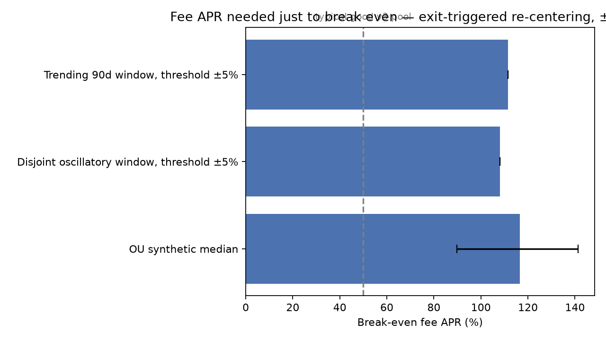

# CLRE: rebalancing a concentrated liquidity position (v3)

Should you auto-rebalance a tight Uniswap v3 position? Mostly no.

- At a width of ±5%, re-centering on exit needs a 111.6% fee APR just to break even on a trending 90-day window, and 108.0% on a separate oscillating one. Very few pools ever pay that.
- Explicit costs (gas and swap fees) are only 3 to 4% of the damage. The rest is the policy itself. Re-centering at its own trigger scale is structurally short realized variance, a discrete LVR maximiser (Milionis et al. 2022), whatever the path structure. The v2 label "short mean reversion" was falsified by the OU control and retracted. The research log keeps the retraction.
- What does depend on the regime is the static tight range (33.5% trending, 1.2% oscillating), not the re-centering decision.



Question. How should a Uniswap v3 style LP position be rebalanced, and what does each policy actually cost?

Full result. A ±5% threshold policy loses on 200 of 200 pure mean-reverting (OU) synthetic paths, with a median break-even of 116.5% (5th to 95th percentile 89.7 to 141.3).

Read first. `final/CLRE_v3.1_Rebalancing_Study_Marco_Amendola.pdf` (4 pages).

## Reproduce

```
python3 tests.py              # 9 of 9 sanity tests, required before any run
python3 reproduce_gate.py     # replays the published numbers from archived inputs
python3 adversarial_check3.py # checks every number in the PDF against runs/*.json (needs pdftotext)
```

The archived hourly inputs for every window are in `runs/`, so the gate runs offline with the standard library. The synthetic study uses seed 42, with parameters logged before the run. The fetch scripts, the PDF build and the figure need the packages in requirements.txt.

## Structure

- `clre.py`. Engine: exact v3 position math, policies, costs, evaluation.
- `tests.py`. Nine-test validation suite.
- `reproduce_gate.py`, `adversarial_check3.py`. Gates.
- `run2.py`, `scan_windows.py`, `build_pdf3.py`. Runs and PDF build. A rerun of `run2.py` writes to `out/` and never overwrites the reference runs. Superseded scripts and earlier PDF versions are in `archive/`.
- `make_figure.py`. README figure.
- `runs/`. Archived inputs and full outputs (run002, run003, run004, run004b, gate, scan, fee anchor).
- `research_log.md`. Pre-registered predictions including the failed ones, two v2 errata, belief updates.
- `adversarial.md`. Both adversarial passes, findings triaged, repairs.
- `brief.md`. Origin and acceptance criteria.

## Method

Predictions were registered before every run. Run 002 failed 2 of 4, and the failures produced the main finding. Run 003 hit 5 of 5 and run 004 hit 4 of 4. The reproduction gate runs before any new run. Fee income is inverted into a break-even APR, not assumed. The pool-level anchor is measured from the DeFiLlama series and published as Dune query 7923963. Known limitations, and how each gap would be closed in production, are stated in the PDF.

## What this means in practice

The break-even numbers are a bar. A pool clears it only if its sustained fee APR exceeds the break-even for your width and regime, and pools paying 100% or more over time are rare and usually paying you for a risk. Before turning on any auto-rebalancing policy:

1. Measure the pool's realised fee APR over a window at least as long as your expected holding period (anchor query: [Dune 7923963](https://dune.com/queries/7923963)).
2. Compare it to the break-even for your width from this study.
3. If it does not clear, a static range, re-chosen only when the regime changes, beat every re-centering policy tested here.

Live monitor: [CLRE Break-Even Monitor on Dune](https://dune.com/x1a0x1a0/clre-break-even-monitor), which shows the top pools that currently clear the bar, refreshed weekly.

Marco Amendola, July 2026. On-chain research under [Xpertknight](https://dune.com/xpertknight). Not investment advice.
